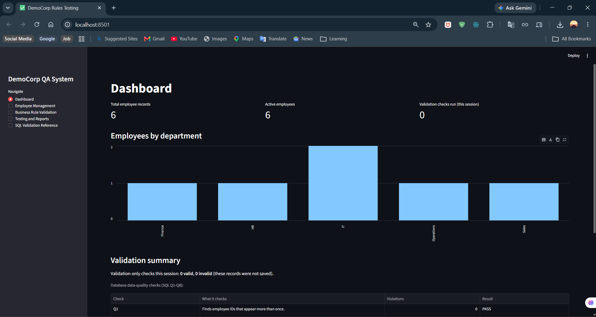
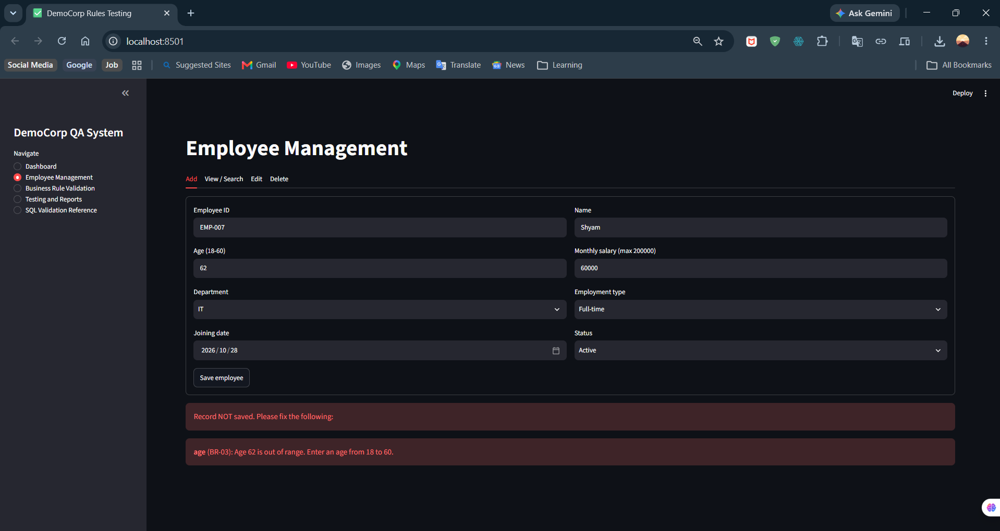
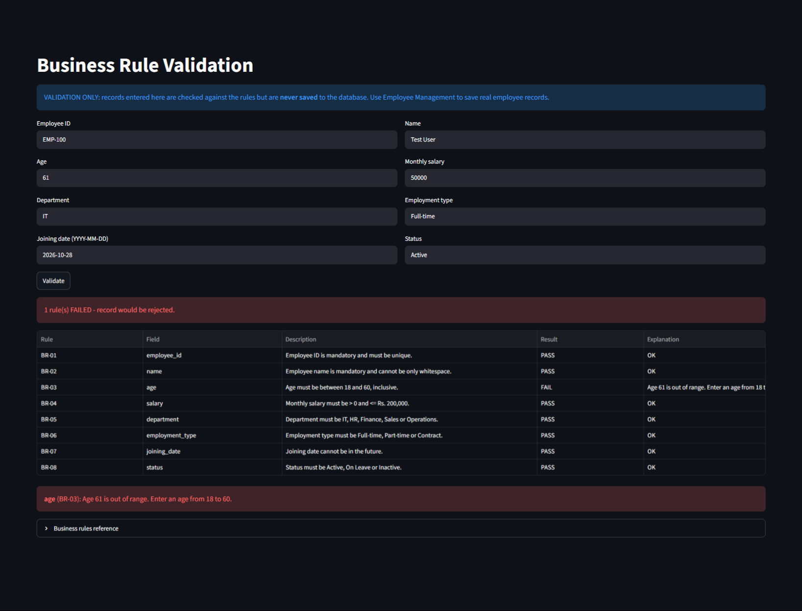
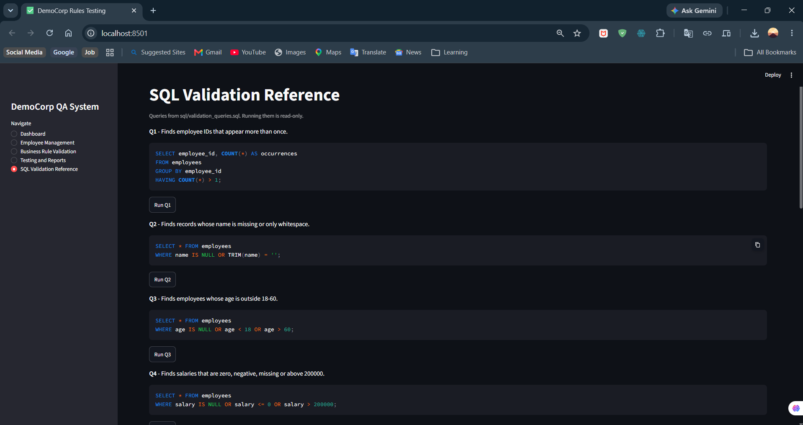
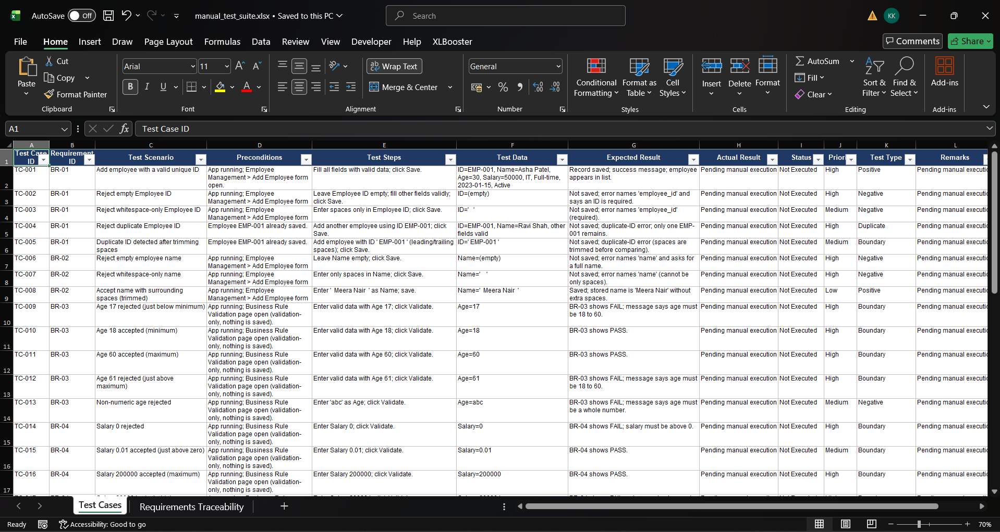
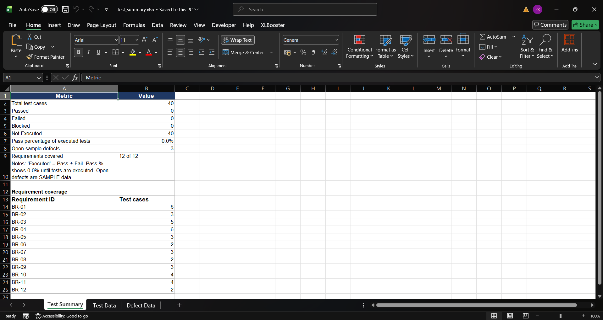

# Business Rules Validation & Manual Testing System

A beginner-friendly QA portfolio project. A small Streamlit app manages fictional **DemoCorp** employee
records, enforces 12 business rules, and comes with a manual test suite, defect log, test summary (Excel),
SQL validation queries and automated Pytest tests.

> **Honesty note:** The 40 manual test cases are *prepared but not executed* (status "Not Executed").
> The defects in `defect_log.xlsx` are **illustrative SAMPLE defects**, not results of real execution.
> The project has not been deployed anywhere. Automated Pytest tests were run (see "Run the automated tests").

## Screenshots
| | |
|---|---|
|  |  |
|  |  |
|  |  |
|  |  |

More images and the full checklist: `docs/screenshots/README.md`.

## Business problem
Wrong employee data (age 61, salary 0, duplicate IDs, future joining dates) causes payroll and reporting
errors. This project shows how a tester turns written rules into test cases, checks the application and
database, logs defects and reports progress.

## Business rules
| ID | Rule |
|----|------|
| BR-01 | Employee ID is mandatory and unique |
| BR-02 | Name is mandatory, not only whitespace |
| BR-03 | Age 18-60 inclusive |
| BR-04 | Salary > 0 and <= Rs. 200,000 |
| BR-05 | Department: IT, HR, Finance, Sales, Operations |
| BR-06 | Employment type: Full-time, Part-time, Contract |
| BR-07 | Joining date not in the future |
| BR-08 | Status: Active, On Leave, Inactive |
| BR-09 | Only valid records are saved |
| BR-10 | Updates must not create duplicate IDs or change other records |
| BR-11 | Deleting requires confirmation |
| BR-12 | Errors name the field and explain the fix |

Assumptions are listed in `docs/requirements.md`.

## Features
- Dashboard (totals, active count, department chart, validation summary, SQL data-quality checks)
- Employee Management (add, list, search, edit, delete with confirmation, field-level errors)
- Business Rule Validation page (PASS/FAIL per rule; validation-only - nothing is saved)
- Testing and Reports (status counts, Excel downloads, template-based scenario/defect drafting)
- SQL Validation Reference (10 read-only queries with explanations; optional run buttons)

## Technology stack
Python 3.11+, Streamlit, SQLite, Pandas, OpenPyXL, Pytest.

## Project structure
```
app.py                  Streamlit UI
validation.py           Business-rule functions (pure, easy to test)
database.py             SQLite access (parameterised SQL)
report_generator.py     Builds the Excel files in output/
ai_assistant.py         Template-based scenario drafting + defect summary (NOT real AI)
sql/schema.sql          Table + constraints
sql/validation_queries.sql   Q1-Q10 read-only queries
tests/                  Pytest tests (isolated temp databases)
docs/                   requirements.md, test_execution_report.md
output/                 manual_test_suite.xlsx, defect_log.xlsx, test_summary.xlsx
```

## Installation (Windows 11, PowerShell)
```powershell
cd business-rules-testing-system
python -m venv venv
venv\Scripts\activate
pip install -r requirements.txt
```
If activation is blocked: `Set-ExecutionPolicy -Scope Process RemoteSigned`.

## Database initialisation
Automatic: `employees.db` is created (empty) the first time the app starts, using `sql/schema.sql`.
To reset, stop the app and delete `employees.db`.

## Run the app
```powershell
streamlit run app.py
```

## Run the automated tests
```powershell
python -m pytest -q
```
Tests use temporary databases, so your real `employees.db` is never touched.

## Excel reports
- Files already exist in `output/`. Download them from the **Testing and Reports** page or open them directly.
- `python report_generator.py` creates only *missing* files (safe: keeps your recorded results).
- `python report_generator.py --force` regenerates everything and **erases recorded results**.
- `python report_generator.py --summary` rebuilds `test_summary.xlsx` from the current suite/defect statuses.
- `manual_test_suite.xlsx` has the 40 test cases plus a Requirements Traceability sheet.
  The Status column has a drop-down: Not Executed / Pass / Fail / Blocked.

## SQL validation
1. Start the app once so `employees.db` exists.
2. Install **DB Browser for SQLite** (free), then *Open Database* -> `employees.db`.
3. Open the *Execute SQL* tab, paste one query from `sql/validation_queries.sql`, press Run.
   Or use the sqlite3 CLI: `sqlite3 employees.db ".read sql/validation_queries.sql"`.
4. For Q1-Q8, **no rows = PASS**. Q9-Q10 are reporting counts. All queries are read-only SELECTs.

## Manual testing workflow
1. **Review** a business rule (`docs/requirements.md`).
2. **Select** a test case in `manual_test_suite.xlsx` (use the Traceability sheet).
3. **Execute** its steps in the app with the listed test data.
4. **Record** what really happened in *Actual Result*.
5. **Mark** Status as Pass, Fail or Blocked.
6. **Log a defect** in `defect_log.xlsx` when actual differs from expected.
7. **Retest** after the developer fixes it; fill *Retest Result*.
8. **Run regression tests** (e.g. TC-034, TC-040, plus tests of related rules).
9. **Validate the database** with the SQL queries (Q1-Q8 should return nothing).
10. **Update the summary**: `python report_generator.py --summary`, and fill `docs/test_execution_report.md`.

## Sample defects
`defect_log.xlsx` holds four defects with IDs starting `SAMPLE-DEF-`: age 61 accepted (TC-012),
edit overwrites another employee's ID (TC-033), whitespace name saved (TC-007), delete without confirmation
(TC-035). They show good defect-writing format (title, steps, expected vs actual, severity, priority).
They are **hypothetical**; the app does not contain these bugs. Replace them with real defects after real testing.

## AI-assisted testing (fallback)
`ai_assistant.py` drafts scenarios from predefined templates per rule and summarises defect text using plain
string processing. It is deterministic and **template-based, not a generative AI model**; it needs no API key.

## Known limitations
- Test cases are not executed; summary shows 0 passed / 0 failed until you record results.
- Single local user; no login or audit trail; SQLite only.
- "Validation checks this session" resets when the browser session restarts.
- Summary workbook copies statuses when generated; re-run `--summary` (or the app button) after updating the suite.
- Regenerating through the app shows formulas that compute when opened in Excel.
- Future-date rule (BR-07) is not a database CHECK (SQLite limitation).

## Interview talking points
- Turned 12 business rules into 40 traceable test cases (positive, negative, boundary, duplicate, CRUD, regression).
- Used boundary value analysis (ages 17/18/60/61, salaries 0, 0.01, 200000, 200001).
- Verified data at the database level with SQL; designed defensively with parameterised queries and constraints.
- Wrote a requirements traceability matrix and defect log with severity/priority.
- Automated rule checks with Pytest using isolated databases; kept manual results honest (Not Executed).

## License
MIT - see `LICENSE`.
